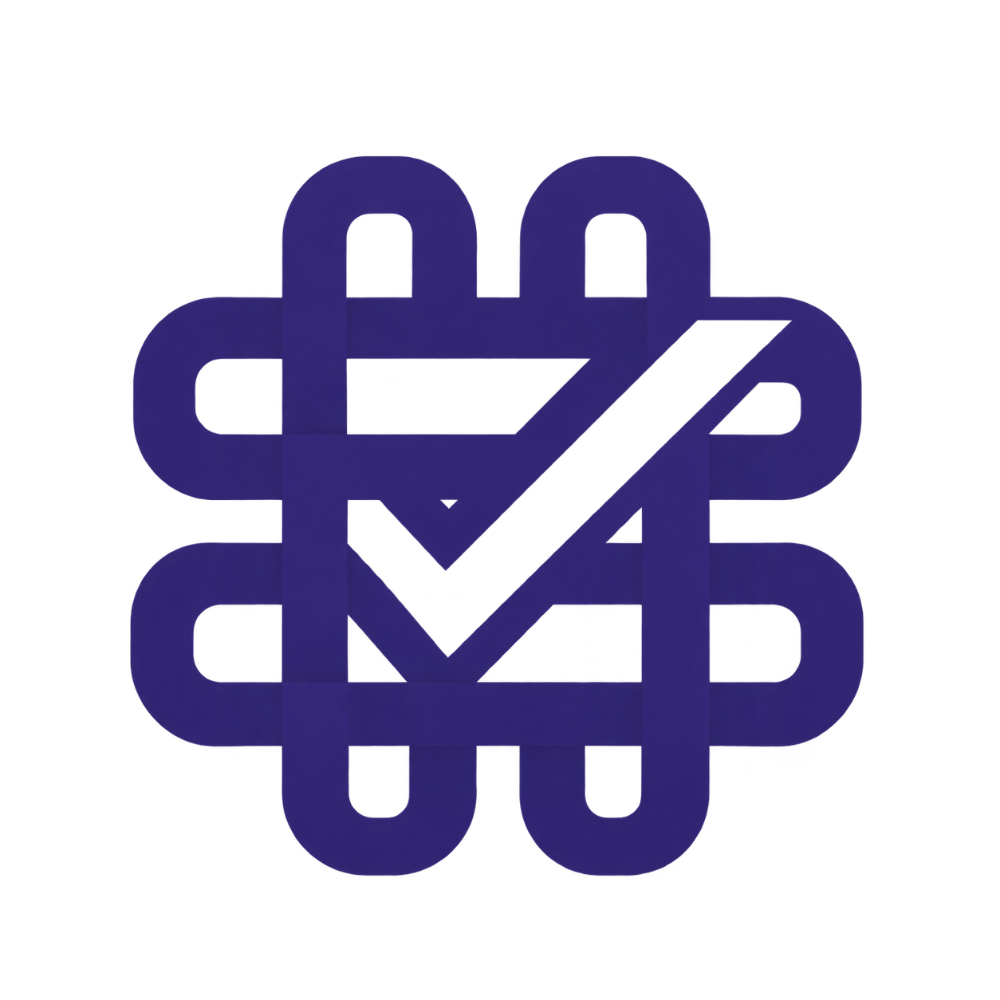

# Jacquard



Deterministic evidence checking for AI-assisted knowledge synthesis.

[](https://pkg.go.dev/github.com/open-and-sustainable/jacquard)
[](https://open-and-sustainable.github.io/jacquard/)

## About

Jacquard is open science software for deterministic evidence checking in
AI-assisted knowledge synthesis. It provides contracts for extracted
claims, their source documents, and evidence reports, with JSON validation through
a Go library, command-line tool, and C shared library.

The [checker contract](docs/checker-contract.md) defines output structure, quote
fidelity, text and numeric support, per-claim evidence reports, and size-based
filter audits.

## Installation (Go)

Go 1.26 or later and a C compiler for the optional shared library are required.
From this checkout:

```sh
go test ./...
go build -o bin/jacquard ./cmd/jacquard
```

Validate a request:

```sh
go run ./cmd/jacquard validate -type input < test/fixtures/check_input.json
```

## Go library

Import the root package to access the public types, schema helpers, and validators:

```go
import "github.com/open-and-sustainable/jacquard"
```

For example, call `jacquard.ValidateInput(inputJSON)` or
`jacquard.ValidateJSON(instance, schema)`. See the
[Go usage example](docs/getting-started.md) for a complete program.

## Documentation

- [User guide](https://open-and-sustainable.github.io/jacquard/)
- [Checker contract](docs/checker-contract.md)
- [Schemas and validation](docs/schemas-validation.md)
- [C-shared library](docs/cshared-library.md)
- [Development and testing](docs/development.md)
- [Go API reference](https://pkg.go.dev/github.com/open-and-sustainable/jacquard)
- [Changelog](CHANGELOG.md)

## Testing

The test suite uses synthetic documents, extractions, populations, and expected
findings. Tests require no models, credentials, external corpora, or network calls.
Go downloads pinned build dependencies during setup; the test suite runs offline.

## Authors and contributions

Riccardo Boero — [ribo@nilu.no](mailto:ribo@nilu.no).
See [contribution guidelines](docs/CONTRIBUTING.md) and the
[code of conduct](docs/CODE_OF_CONDUCT.md).

## License

Apache License 2.0. See [LICENSE](LICENSE).

## Citation

> Boero, R. Jacquard - Deterministic evidence checking for AI-assisted knowledge synthesis. Software. [GitHub](https://github.com/open-and-sustainable/jacquard).

Machine-readable citation metadata is in [CITATION.cff](CITATION.cff).
